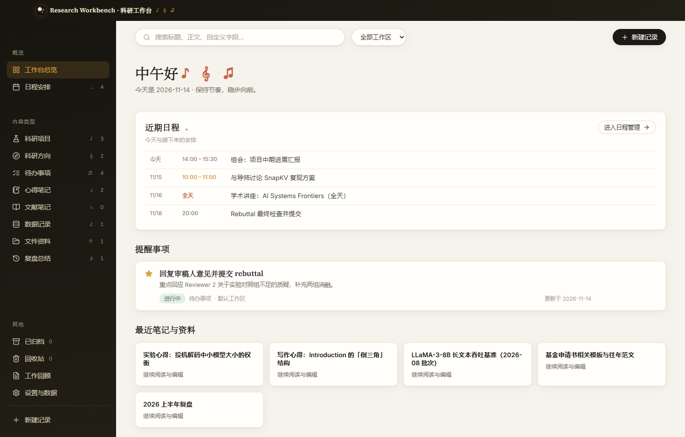
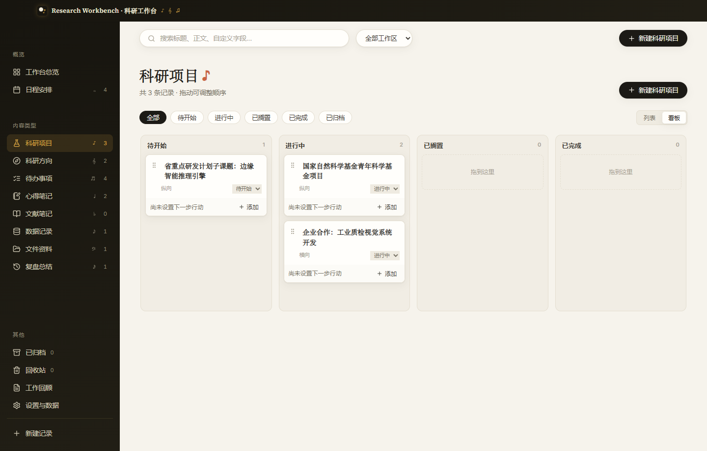
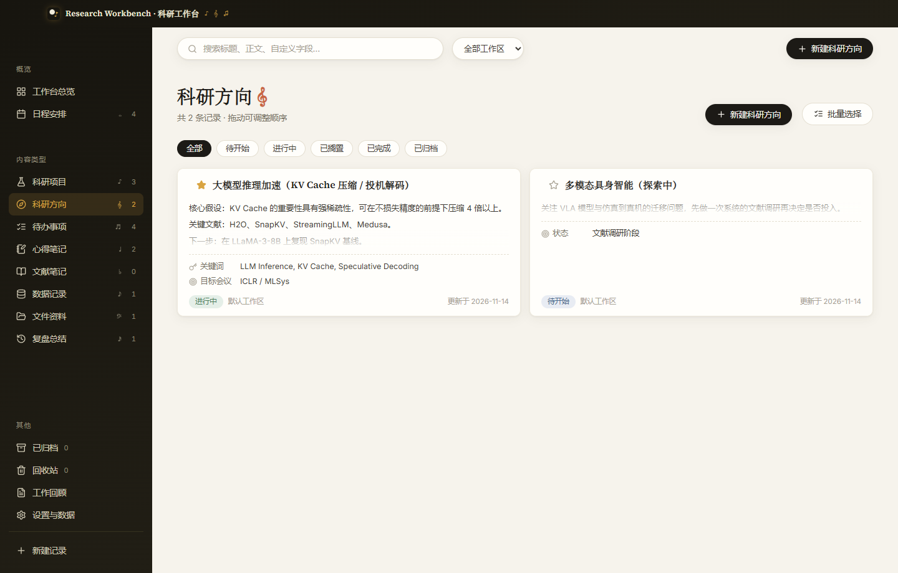
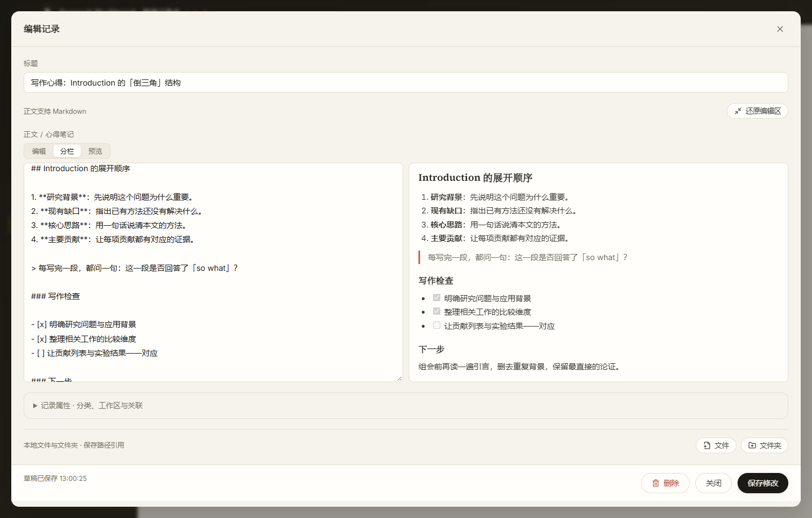
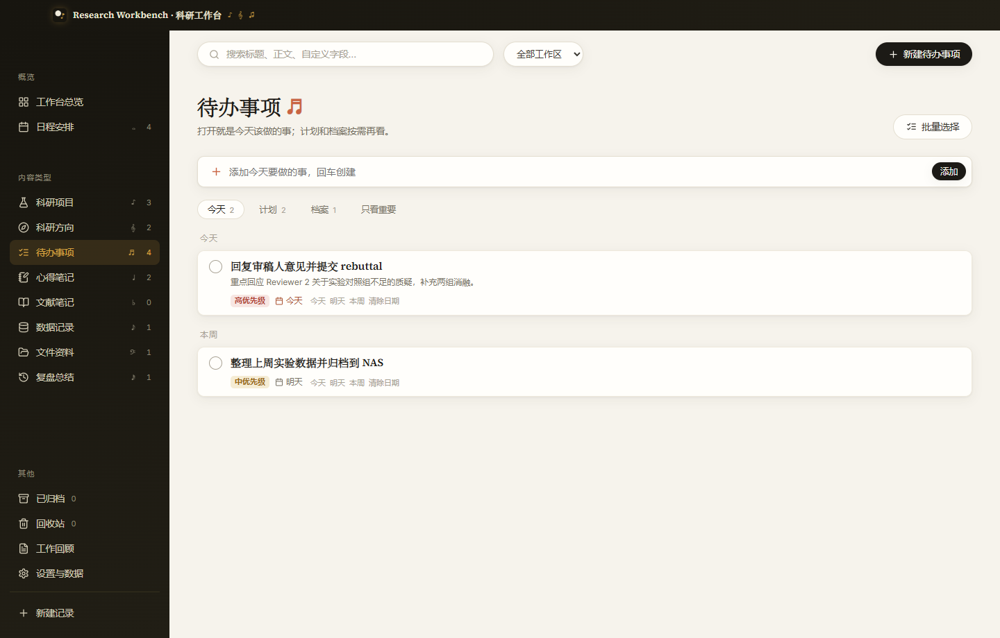

<div align="center">
  

  <h1>Research Workbench · 科研工作台</h1>

  <p><strong>一张桌面，接住科研中的项目、方向、待办与日程。</strong></p>
  <p>A local-first desktop organizer for research projects, tasks, schedules, and notes.</p>

  <p>
    <a href="https://github.com/Layman-art/Research-Workbench/releases/latest"></a>
    
    
    
    <a href="./LICENSE"></a>
    <a href="https://github.com/Layman-art/Research-Workbench/releases"></a>
  </p>

  <p>
    <a href="https://github.com/Layman-art/Research-Workbench/releases/download/v2.0.0/Research.Workbench_2.0.0_x64-setup.exe"></a>
    <a href="https://github.com/Layman-art/Research-Workbench/releases/download/v2.0.0/Research.Workbench_2.0.0_aarch64.dmg"></a>
  </p>
  <p><sub>v2.0.0 · Windows 4.45 MB · macOS 6.62 MB · 无需账号，打开即用</sub></p>

  <p>
    <a href="#快速开始">快速开始</a> ·
    <a href="#功能一览">功能一览</a> ·
    <a href="#界面预览">界面预览</a> ·
    <a href="#数据与隐私">数据与隐私</a> ·
    <a href="#本地开发">参与开发</a>
  </p>
</div>

<p align="center">
  
  <br><sub>工作台总览 · 今天的安排、待办与研究记录，都在这里。</sub>
</p>

> **v2.0.0 已发布**：更可靠的长笔记保存、可恢复的草稿、每日备份与回收站，以及跨天自动刷新。[查看本版更新 →](./docs/releases/v2.0.0.md)

## 为什么做 Research Workbench？

科研信息很容易散落在项目表、日历、待办软件和零碎笔记中：项目进行到哪一步、当前主攻什么方向、下一个截止日期是什么，往往需要在多个地方反复查找。

Research Workbench 把这些线索放回同一张桌面。打开工作台，就能接着上次的笔记继续写，为项目安排下一步，或回顾这一周完成了什么。

| 你关心的事 | 在工作台中 |
| --- | --- |
| 项目推进到哪一步了？ | 纵向 / 横向项目分类、状态看板与关联待办 |
| 今天先做什么？ | 我的日程、到期提醒与今日重点 |
| 上次的想法和资料在哪里？ | Markdown 笔记、全局搜索与本地文件引用 |
| 这周有哪些进展？ | 活动记录与周报、月报导出 |

## 功能一览

### 🧭 项目与研究方向

- 纵向 / 横向项目分类，支持列表与看板视图
- 研究方向、项目状态、自定义字段与拖拽排序
- 将笔记、待办和日程关联到项目，集中查看下一步行动

### ✅ 待办与日程

- 「今天 / 计划 / 档案」分组、重要标记与循环待办
- 截止日期、优先级、系统通知与周日程
- 常驻托盘与开机自启，跨午夜或睡眠唤醒后自动更新日期

### 📝 笔记与科研资料

- Markdown 编辑、分栏预览、长文展开与自动草稿恢复
- 全局搜索、文献 DOI、本地文件和文件夹引用
- 多工作区、自定义记录类型、批量操作与多格式导出

### 🔒 本地保存与数据恢复

- 无需账号，核心功能离线可用，数据保存在本机
- 每日自动备份保留最近 30 份，回收站保留 30 天
- 保存失败保留内容，支持导入预览、手动备份与恢复

## 界面预览

<table>
  <tr>
    <td width="50%" align="center">
      
      <br><sub>科研项目 · 按状态推进，随时掌握进展</sub>
    </td>
    <td width="50%" align="center">
      
      <br><sub>科研方向 · 主次方向与过程记录</sub>
    </td>
  </tr>
  <tr>
    <td width="50%" align="center">
      
      <br><sub>科研笔记 · 安心记录，边写边预览</sub>
    </td>
    <td width="50%" align="center">
      
      <br><sub>待办事项 · 把想法变成下一步行动</sub>
    </td>
  </tr>
</table>

<p align="center"><sub>以上为 v2.0.0 界面，使用示例数据展示；同时支持浅色、深色和跟随系统主题。</sub></p>

## 快速开始

1. 点击页面上方的下载按钮，或前往 [Releases](https://github.com/Layman-art/Research-Workbench/releases/latest) 选择对应平台。
2. **Windows**：运行 `.exe` 安装程序。**macOS（Apple Silicon）**：打开 `.dmg`，将应用拖入「应用程序」。普通用户无需安装 Node.js 或 Rust。
3. 首次打开会载入可编辑的科研示例数据，可以从一个项目、一条待办或一篇笔记开始。

> [!IMPORTANT]
> **旧 Windows 版升级：先在旧版导出 JSON，再在新版「设置与数据」中预览并导入**。导入会替换新版当前数据，请先备份已有内容。旧 macOS 版沿用原数据目录，升级前也建议另存一份 JSON。

<details>
<summary><strong>安装与后台运行说明</strong></summary>

- 安装包尚未完成正式代码签名及 macOS 公证，首次安装可能出现系统提示。请从本仓库 Releases 下载。
- 默认关闭主窗口后仍驻留托盘；需要彻底退出时，在托盘菜单选择「退出」。也可以在设置中关闭后台运行。
- 开机自启可安静驻留托盘；软件运行期间会处理已启用的到期提醒。

</details>

## 数据与隐私

**你的科研记录保存在自己的电脑上**。Windows 与 macOS 均使用本地 SQLite，无需账号，核心功能离线可用。数据库备份包含记录、草稿与回收站；JSON 可用于迁移与可移植备份。

文件和文件夹引用只保存路径，不复制原文件。自动备份保存在同一设备，重要内容仍建议另存到其他存储介质。当前不提供云同步、实时协作或应用层加密，详见 [隐私说明](./PRIVACY.md)。

## 本地开发

Windows 与 macOS 共用 `desktop/` 下的 **Tauri 2 + SQLite + React + TypeScript** 实现。

<details>
<summary><strong>展开开发环境、运行与构建命令</strong></summary>

推荐 Node.js 24、npm 与 Rust stable。Windows 原生构建需要 Visual Studio C++ Build Tools、Windows SDK 和 WebView2；macOS 需要 Xcode Command Line Tools。

```bash
git clone https://github.com/Layman-art/Research-Workbench.git
cd Research-Workbench
npm ci
npm run dev:desktop
```

浏览器界面预览可用 `npm run dev`；原生备份、系统通知与文件引用请在桌面版中验证。

```bash
npm run check
npm run test:e2e
npm run dist:win
# 在 macOS 上构建：
npm run dist:mac
```

```text
desktop/src/        两个平台共用的界面与业务逻辑
desktop/src-tauri/  SQLite、备份、托盘与原生集成
desktop/src/test/   单元测试与界面回归测试
docs/assets/       README 展示图片
docs/releases/     版本说明
```

完整开发指南见 [desktop/CONTRIBUTING.md](./desktop/CONTRIBUTING.md)。

</details>

## 参与贡献

欢迎提交 [Issue](https://github.com/Layman-art/Research-Workbench/issues) 或 Pull Request。开始前可阅读 [贡献指南](./CONTRIBUTING.md)，反馈问题时请勿附上未脱敏的科研数据。

感谢 [Zhong0118 的 macOS 适配贡献](https://github.com/Layman-art/Research-Workbench/pull/1)，为 v2.0.0 的跨平台统一提供了基础。

---

<p align="center">
  <a href="./LICENSE">MIT License</a> ·
  <a href="./THIRD_PARTY_NOTICES.md">第三方组件</a> ·
  <a href="./CHANGELOG.md">更新日志</a> ·
  <a href="https://github.com/Layman-art/Research-Workbench/releases">下载历史版本</a>
</p>
